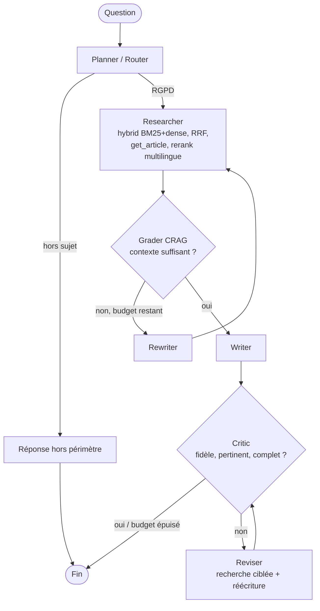

# RAG agentique multi-agents (LangGraph) — analyse, conception et évaluation

> Ce document explique **pourquoi** on est passé d'un RAG avancé « linéaire » à un
> **RAG agentique multi-agents**, **comment** il fonctionne, et **comment on démontre**
> avec RAGAS qu'il obtient de meilleurs scores. Tout tourne **en local** avec Ollama.

---

## 1. Analyse du RAG avancé existant (baseline)

Pipeline actuel (`backend/app/services/retriever.py` + `pipeline.py`) :

```
question → multi-query (4 variantes LLM) → top-6 chunks / variante → parent recovery
        → rerank cross-encoder (top-3 articles) → prompt RGPD en 5 sections → réponse
```

**Ce qui est bien fait** : stratégie parent/child (petits chunks pour chercher, article
complet pour générer), multi-query, reranking, routeur sans LLM pour « article N »,
IDs déterministes (`chapitre::article`).

**Ce que montrent les résultats RAGAS d'origine** (`evaluation/resultats_gold_set*.csv`, juge Mistral) :

| Métrique | gold_set | gold_set2 |
|---|---|---|
| Faithfulness | 0,803 | 0,735 |
| Answer relevancy | 0,670 | 0,683 |
| Context precision | 0,850 | 0,908 |
| Context recall | 0,900 | 0,800 |

**Diagnostic question par question** :

1. **Échec de récupération sur des questions « évidentes »** — Q1 « Quels sont les
   principes relatifs au traitement… ? » obtient *precision = recall = 0* : le système
   renvoie les articles 13 et 39 au lieu de l'**article 5**, dont le *titre* est
   précisément « Principes relatifs au traitement… ». Cause : seuls les chunks de
   **contenu** sont vectorisés, **sans le titre** de l'article.
2. **Reranker anglais sur un corpus français** — `ms-marco-MiniLM-L-6-v2` est entraîné sur
   MS MARCO (anglais) : son classement est peu fiable sur du texte juridique français.
3. **Top-3 fixe** — les questions transversales (droits de la personne : art. 15 à 21 ;
   transferts : art. 44 à 49 ; DPO : art. 37 à 39) exigent plus de 3 articles → recall limité.
4. **Gabarit en 5 sections → hallucinations « génériques »** — les sections
   « Points de vigilance » et « Recommandation pratique » poussent le LLM à ajouter des
   conseils absents du contexte. D'où des faithfulness très basses (0,27 ; 0,26 ; 0,18)
   alors que le contexte était bon.
5. **Aucune boucle de rétroaction** — si la recherche échoue ou si la réponse est
   infidèle, rien ne le détecte ni ne le corrige. Les modes « CRAG / HyDE / Self-RAG »
   de l'interface étaient de simples étiquettes.

---

## 2. Le RAG agentique : principes retenus

Inspiré des cours IBM / Coursera **« Agentic AI with LangChain and LangGraph »** et
**« Multi-Agent Systems and Agentic RAG with LangGraph »**, ainsi que des articles de
référence :

| Idée | Source | Où dans le code |
|---|---|---|
| Graphe d'état partagé, nœuds/arêtes conditionnelles, boucles | LangGraph | `agentic/graph.py` |
| **Routage** + **décomposition** de la requête (planner) | Agentic RAG (IBM) | `planner` |
| **Corrective RAG** : évaluer les documents, reformuler si insuffisant | Yan et al., 2024 (CRAG) | `grader` → `rewriter` |
| **Self-RAG** : vérifier que la réponse est appuyée par le contexte | Asai et al., 2023 | `critic` |
| **Reflection / Reflexion** : auto-critique verbale → révision, avec recherche ciblée | Shinn et al., 2023 | `critic` → `reviser` |
| **Multi-agents** : un agent = un rôle, un prompt, une sortie structurée | IBM multi-agent | `agentic/prompts.py` |
| **Retrieval hybride** dense + BM25, fusion RRF | Cormack et al., 2009 | `agentic/tools.py` |

### Les agents

| Agent | Rôle | Sortie (Pydantic → JSON contraint par Ollama) |
|---|---|---|
| **Planner / Router** | route (RGPD / hors-sujet), décompose en 1–3 sous-requêtes, propose des articles candidats | `Plan` |
| **Researcher** | appelle les outils : `hybrid_search` (dense + BM25 + RRF), `get_article(n)`, `rerank` (cross-encoder **multilingue**) | candidats classés |
| **Grader (CRAG)** | garde uniquement les articles réellement utiles, dit si c'est suffisant et ce qui manque | `Grade` |
| **Rewriter** | si insuffisant : nouvelles requêtes + nouveaux articles → retour au researcher | `Rewrite` |
| **Writer** | premier jet avec **le même prompt que la baseline** (comparaison équitable) | texte |
| **Critic (Reflection)** | fidélité, pertinence, complétude ; liste les affirmations non fondées / manques / superflus ; propose des requêtes | `Critique` |
| **Reviser (Reflexion)** | recherche complémentaire guidée par la critique, puis réécriture sans les affirmations non fondées | texte |

### Le graphe



Les boucles sont **bornées** (`AGENTIC_MAX_RETRIEVAL_LOOPS=1`, `AGENTIC_MAX_REFLECTIONS=2`)
pour garantir la terminaison et une latence maîtrisée. Chaque agent a un **repli**
déterministe si le modèle local renvoie un JSON invalide.

---

## 3. Pourquoi l'agentique doit mieux scorer sur RAGAS

| Métrique RAGAS | Faiblesse de la baseline | Réponse agentique |
|---|---|---|
| **Context recall** | top-3 fixe, titres non indexés, une seule passe | décomposition en sous-requêtes, BM25 sur articles **avec titre**, articles candidats, boucle CRAG de reformulation, recherche Reflexion |
| **Context precision** | articles « voisins » gardés par un reranker anglais | reranker multilingue + **grader** qui écarte les articles non pertinents |
| **Faithfulness** | conseils génériques non sourcés | le **critic** liste les affirmations non fondées, le **reviser** les supprime |
| **Answer relevancy** | réponses longues, digressions | le critic signale les passages superflus ; la révision commence par la réponse directe |

> **Honnêteté méthodologique** : les deux systèmes utilisent le même LLM, le même index,
> les mêmes embeddings, le même prompt de premier jet et le même juge. Deux briques
> « outils » de l'agent (BM25 hybride, reranker multilingue) améliorent aussi la recherche
> en elles-mêmes : elles font partie de la boîte à outils de l'agent researcher.

---

## 4. Modèles locaux (Ollama, 32 Go de RAM)

| Rôle | Modèle par défaut | Taille (Q4) | Pourquoi |
|---|---|---|---|
| LLM du RAG (baseline **et** agents) | `qwen2.5:7b` | ≈ 4,7 Go | très bon en français, fiable en **sortie JSON structurée** (indispensable pour les agents), rapide |
| Juge RAGAS | `qwen2.5:14b` | ≈ 9 Go | plus grand que le modèle évalué, JSON robuste, température 0 |
| Embeddings | `paraphrase-multilingual-MiniLM-L12-v2` | HF, CPU | inchangé (index ChromaDB existant) |
| Reranker agentique | `mmarco-mMiniLMv2-L12-H384-v1` | HF, CPU | cross-encoder **multilingue** |

Les deux modèles Ollama tiennent ensemble en mémoire (≈ 14 Go + cache de contexte) avec
32 Go de RAM. Alternatives possibles via `.env` : `mistral-nemo` (12B, déjà installé),
`qwen3:8b` (le mode « thinking » est désactivé automatiquement), `gpt-oss:20b` en juge.

```dotenv
# .env (racine) — tout est optionnel, ce sont les valeurs par défaut
LLM_PROVIDER=ollama
LLM_MODEL=qwen2.5:7b
JUDGE_PROVIDER=ollama
JUDGE_MODEL=qwen2.5:14b
OLLAMA_BASE_URL=http://localhost:11434
```

---

## 5. Lancer l'évaluation comparative

```bat
scripts_windows\TOUT_LANCER.bat            :: installe, évalue les 2 gold sets, publie
:: ou étape par étape
scripts_windows\1_installer.bat            :: dépendances + ollama pull
scripts_windows\2_evaluer.bat --limit 3    :: test rapide sur 3 questions
scripts_windows\2_evaluer.bat --gold gold_set.json gold_set2.json
```

ou directement :

```bash
python evaluation/evaluation_comparative.py --gold gold_set.json gold_set2.json
```

Sorties dans `evaluation/results/` :

- `comparaison_<gold>.md` — tableau baseline vs agentique (+ Δ)
- `comparaison_<gold>.png` — graphique en barres
- `resultats_<gold>_<système>.csv` — détail par question (réponse, contextes, trace des agents, scores)
- `generations_*.json`, `scores_*.json` — caches : **relancer la commande reprend le calcul**
- `run_log.txt` — journal complet

## 6. Utiliser le mode agentique dans l'application

- API : `POST /query` avec `"mode": "agentic"` → la réponse contient en plus `trace`
  (les étapes suivies par chaque agent).
- Frontend : mode **« RAG Agentique »** dans le sélecteur de mode.
